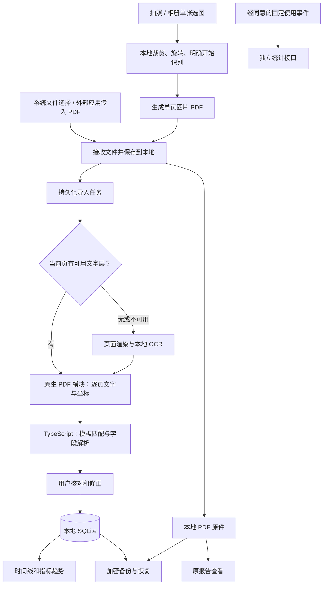

> **历史快照，不是当前说明。** 保存于 2026-10-23 文档同步前；其中规划与实现曾有混用。当前入口见 [README](../../README.md) 和 [状态与待办](../当前状态与待办.md)。

# 个人健康记录 App · 技术方案 v0.4（本地 OCR 与多版式表格）

日期：2026 年 10 月 23 日  
依据：《个人健康记录App-产品方案-v0.2.md》  
状态：已有两端验证版；本次增加按表头定位的通用表格解析，并用 9 张公开科普报告示例在两端模拟器验证。保留原浙一适配；新格式仍有缺项、误读，暂不自动加入跨医院趋势。详见《docs/多版式OCR测试.md》。保留原文件名，避免原有文档链接失效。

后续待实施设计：[报告解析增强方案 v0.1](../../个人健康记录App-报告解析增强方案-v0.1.md)，针对多页体检报告补充分区、跨页表格、文字结果、小表格及重新识别兼容。本链接不表示这些能力已实现。

## 1. 技术决策

**使用 React Native + TypeScript 开发 iOS 和 Android。用 Expo 管理项目、调试和本地编译；在 Mac 的模拟器和两端真机上测试。**

业务逻辑、页面、指标解析和数据访问共用代码。文件接收、PDF 底层读取及部分系统存储配置分别适配 iOS 和 Android。

首个验证版本就在两个系统上跑通“导入两份报告 → 核对 → 保存 → 查看变化”。可以先调通一端，再立即验证另一端；最终交付和验收都包含两端。

首版支持已验证模板的文字 PDF，以及没有可用文字层的 PDF（扫描图像或轮廓文字）。逐页自动选择文字提取或本地 OCR，用户无需判断 PDF 类型。拍照和相册图片先在本机裁剪、旋转，再进入本地识别。未匹配固定模板时尝试通用表格解析；表头或行列证据不足时保留原件并明确未完成字段提取。识别出文字不等于识别出指标。

## 2. 使用的工具

| 部分           | 选择                                                   | 用途                                                                                                     |
| -------------- | ------------------------------------------------------ | -------------------------------------------------------------------------------------------------------- |
| App            | React Native + TypeScript                              | 页面和共用业务逻辑，开启严格类型检查                                                                     |
| 项目与调试     | Expo + expo-dev-client                                 | 在本机编译并安装 App 调试版，修改 JS／TS 后热重载                                                        |
| 页面导航       | Expo Router                                            | 记录、指标、导入核对、详情和设置                                                                         |
| 本地数据库     | expo-sqlite，开启 SQLCipher                            | 保存结构化记录、解析任务、确认状态和数据库版本                                                           |
| 文件与密钥     | expo-file-system、expo-secure-store                    | 管理原件和临时文件；密钥放入系统安全存储                                                                 |
| App 内选文件   | expo-document-picker                                   | 从系统文件应用选择 PDF                                                                                   |
| 拍照与选图     | expo-image-picker                                      | 调用系统相机和相册选择器，按需申请相机权限                                                               |
| 图片整理       | expo-image-manipulator、自定义裁剪组件                 | 本地归一化方向、限制尺寸、旋转及裁剪，不传图片 Base64 给 JS                                              |
| PDF 读取与预览 | 本地 Expo 模块：iOS PDFKit；Android PDFium             | 读取文字及坐标、按页显示原报告                                                                           |
| 本地 OCR       | iOS 系统 Vision；Android ML Kit 中文识别内置模型       | 缺少可用文字层时渲染页面并离线识别，不调用云端 OCR 或 LLM；Android 使用 bundled 依赖，不依赖首次下载模型 |
| 指标计算与绘图 | decimal.js、react-native-svg                           | 用十进制规则计算差值，绘制简单趋势线                                                                     |
| 本地自动测试   | Jest、jest-expo、React Native Testing Library、Maestro | 测试解析规则、交互和安装后的完整流程                                                                     |

Expo 与其配套的 React Native、React 版本一起选定和锁定，不各自升级。依赖使用 `npm` 和 `package-lock.json` 管理；Node、JDK、Xcode、Android SDK 版本记录在开发说明中。

原生 PDF 模块通过 Expo Modules API 编写。Android 封装以 PdfiumAndroidKt 为候选，P0 验证文字与坐标接口、许可证、维护状态、目标 ABI 和 16 KB 内存页兼容性后锁定版本。不能把“可以预览 PDF”当作“可以提取字段”的证明。

## 3. 整体结构



病历处理链路只访问本地文件和数据库。统计代码只接收明确列出的事件字段，不接收报告对象。账号服务不作为首版运行依赖。

### 建议目录

以下是目标目录结构；实际实施范围与验收证据以 README 和实施记录为准。

```text
doctor/
  个人健康记录App-产品方案-v0.2.md
  个人健康记录App-技术方案-v0.1.md
  app/                        # Expo Router 页面
  src/
    features/                 # 导入、核对、时间线、指标、设置
    domain/                   # 报告模型、比较规则、日期与单位处理
    parser/                   # 纯 TypeScript 模板解析，无 React 依赖
    db/                       # SQL、迁移、查询和事务
    services/                 # 导入任务、备份、统计
  modules/
    local-pdf/                # Swift / Kotlin PDF 读取和原生页面视图
    file-inbox/               # 外部文件接收和暂存
    backup-crypto/            # 备份流式加密封装
  plugins/                    # 生成文件类型声明、分享扩展和系统配置
  tests/
    fixtures/                 # 可公开的合成 PDF、布局数据和人工期望值
    parser/                   # 字段、日期、单位、比较规则测试
    components/               # 核对、纠错和状态提示测试
  .maestro/                   # 两端设备端流程
  services/analytics/         # 独立的使用统计服务
  private-fixtures/           # 授权真实样本，仅本机保存，Git 忽略
```

原生模块及配置插件是代码源文件。生成的 `ios/`、`android/` 工程可重建，不能只在其中手改后遗失配置；P0 要验证重新生成工程后两端仍可构建。

## 4. PDF 与图片导入解析

### 4.1 两种入口进入同一条处理链路

**App 内导入：** 系统文件选择器 → 取得可读副本 → 复制到 App 的持久化目录 → 建立导入任务。选择器缓存和临时 URI 都不能当作长期保存位置。

**外部应用打开／分享：** 依据实际收到的系统事件接收文件，随后进入同一导入服务。

| 系统    | 实现方式                                                                                                | 必须验证的行为                                                   |
| ------- | ------------------------------------------------------------------------------------------------------- | ---------------------------------------------------------------- |
| iOS     | 声明支持 PDF 文档打开；处理文件 URL 和安全作用域访问。分享入口采用 Share Extension + App Group 暂存文件 | 支付宝实际触发“打开”还是“分享”；冷启动、取消、文件权限和签名配置 |
| Android | 接收 PDF 对应的 `ACTION_VIEW`、`ACTION_SEND`；读取 `content://` URI 时使用系统授权并立即复制            | 冷启动与已打开状态、临时授权、重复 Intent 和文件提供者差异       |

iOS 分享扩展只做短时接收和暂存，显示“已保存，打开 App 后继续导入”。主 App 下次进入前台时读取待处理文件，不依赖分享扩展强制拉起主 App。App Group 暂存文件在主 App 接收成功后清理。

真机测试分享扩展前，检查开发团队是否具备 App Groups 签名能力；主 App 和扩展需配置对应的标识与授权。系统文件选择流程可以先独立验证。

截至本次查阅，Expo 官方 `expo-sharing` 的接收分享功能仍标注实验性，其 iOS 实现依赖官方不支持的拉起主 App 行为，因此不作为首版 iOS 导入入口的实现基础。导出文件可使用其常规系统分享能力。

P0 就在真实支付宝中测试入口。若某端不能直接交接文件，保留“保存到文件 → App 内选择”的可用路径，并在支持说明中写清楚。

### 4.1.1 拍照与相册入口（已实现）

`app/photo.tsx` 使用 `expo-image-picker` 打开系统相机或单张图片选择器。仅拍照时请求相机权限；拒绝后显示设置与相册入口。相册走系统选择器，不请求整库读取权限。Android 启动时检查 `getPendingResultAsync()`，恢复选择器导致 Activity 重建后返回的图片。取消不创建报告。

1. 接受选择器返回的本地图片，检查尺寸和文件大小（不超过 2400 万像素、40 MB）；使用 `expo-image-manipulator` 处理方向并转为不保留 EXIF 的 JPEG，长边不超过 3200 像素，不上采样小图。裁剪框四角和中间区域可拖动，支持 90 度旋转、恢复裁剪和重新选择。
2. 用户点“开始识别”后才生成最终裁剪 JPEG。原生 `PhotoDocument` 用 iOS `UIGraphicsPDFRenderer` / Android `PdfDocument` 将像素嵌入单页 PDF，保持比例，以同一坐标系复用 OCR、行截图、重试、删除和导出。原生再次校验尺寸上限；处理后的图片和 PDF 沿用 20 MB 文件限制。
3. 去重键为 `image:` 加裁剪 JPEG 文件的 SHA-256，不以含动态元数据的 PDF 计算去重。只判定处理后内容完全一致，不对两次拍照做相似图片合并。
4. 先复制原件、登记持久化任务，再开始 OCR。OCR 失败时保留原件供重试或手动整理；转换前失败不创建记录。使用与 PDF 相同的串行导入队列；界面处理期间禁用重复点击和离开操作。保存后的查询不重新 OCR。
5. `DocumentRecord.sourceType?: 'image'` 存入现有文档 JSON；没有此字段的旧文档按 PDF 处理，不需要新增数据库迁移。图片文档初始页数为 1，失败后也可查看。图片识别和重新识别的候选指标保留 `needsReview` 与通用提醒；只有具体疑点进入逐项核对计数，通用提醒在整份报告明确保存时确认。不能因规则匹配就保证正确。
6. 查看图片时复用全页渲染和 `ZoomableSourceImage`，两端均可手势缩放；行图片仍使用现有缩略图和大图浮层。导出明确标注“导出图片报告（PDF）”。保存的是用户确认后的裁剪图；相册原图不被修改。
7. 选择器缓存副本、处理图片应用文件保护，离开编辑器时清理；中间 PDF 在 `finally` 清理，持久原件沿用现有私有目录、备份排除和删除流程。系统强杀时无法保证执行清理，残留临时文件位于 App 缓存目录。不会读取或上传其他相册图片。

新增原生依赖和转换方法后，需重新编译安装 iOS、Android Development Build。iOS 模拟器不能实拍，使用合成图片验证相册流程；真机还需测试相机、HEIC、不同方向、反光与拍摄畸变。当前不实现批量选图、多页合并、自动透视校正、自动模糊检测或手写识别，不新增云端服务或 LLM。

### 4.2 原生层读 PDF，TypeScript 负责字段含义

原生模块逐页输出：

```ts
type TextSpan = {
  text: string;
  confidence?: number;
  rect: { x: number; y: number; width: number; height: number };
};
type LayoutPage = {
  pageIndex: number; // 从 0 开始
  width: number;
  height: number;
  extractionMethod?: 'text' | 'ocr';
  spans: TextSpan[];
  numericSpans?: TextSpan[]; // 辅助识别结果，用于补缺和分歧提示
  tableSpans?: TextSpan[]; // 不同尺寸的中文读取，供通用表格候选比较
};
```

坐标统一为旋转、裁剪处理后的页面左上角原点，并归一化到 0–1。保留中文、上下标、运算符与原始文本，不能先清洗成一串字符串再猜行列。

处理顺序：

1. 检查文件是否可读、页数和资源上限；损坏或受保护文件返回明确状态。
2. 原生层在工作线程逐页检查文字数量和乱码比例；无可用文字、旋转等情况走本地 OCR。OCR 用白底页面位图，每次只保留一页，长边不超过 3200 像素；设置 120 秒处理循环预算和字符数量上限（不能强制中断单次系统 OCR 调用），不把整份 PDF 的 Base64 传入 JS。
3. TypeScript 优先匹配已验证模板，否则动态定位项目、结果、单位、参考范围表头，分别解析左右表；要求至少 3 行结果/范围有效，且不少于候选行的 65%。只记录明确识别出的采样日期；无法可靠构成表格时不猜字段。
4. 执行格式与一致性检查，记录来源页和区域。对已适配 OCR 模板中缺失的结果值，依据该行与结果列定位单元格，局部放大后补读；每份文件最多补读 12 格、单独设置 30 秒循环预算，不能中断单次系统识别调用。仅补缺，不替换已读出的非空结果。补读失败保留初始结果，空格不能默认填 0。无法确定的内容进入待核对。
5. 保存解析结果及解析器版本，进入核对页面；只有已有指标映射、标本和方法依据的项目在用户确认后进入趋势，通用新格式当前仅核对和保存。

一个 PDF 可以包含多份报告；需要根据报告编号、患者、日期和页头识别边界，不能把整份文件强行赋予一个日期。部分页面不支持时，要保留并展示未处理页清单。

原生模块同时提供按页预览能力，核对页面可定位来源区域。原始文件始终是核对依据。

### 4.2.1 本地 OCR 与真实模板

- iOS 使用 Vision 的准确模式、简体中文及英语；模型由操作系统提供。Android 使用 `com.google.mlkit:text-recognition-chinese` 内置模型，由 PdfRenderer 生成位图。两端均不上传报告、不按识别次数付费。
- Android 官方参考增量约为每文字体系、每 CPU 架构 4 MB；实际依赖和 APK 增量必须实测，不把参考值当安装包承诺。iOS 不额外捆绑 OCR 模型。当前 arm64 Android Debug APK 约 87.95 MiB，其中 OCR 原生库和模型文件合计约 12 MiB；这不是正式包体积或精确安装增量，Release 压缩和分发需另测。
- 返回文字、坐标、来源方式及可用置信度。iOS 采用中英文主识别与英文辅助读取，Android 采用整页与分片辅助读取；主要字段以主识别为准，辅助结果用于补缺、单位校验与分歧提示。先验证浙一余杭血常规的单表和左右双表版式；表头、列位置、患者、采集日期及样本类型必须匹配。双表分别解析，不能将左表结果与右表项目拼在一起。
- 原报告的 ↑ 表示高于参考范围，↓ 表示低于参考范围，作为独立的 `reportFlag` 保存和展示，不拼入数值、不表示相对上次的变化，也不据此作医学判断。仅保留读到的方向，不按数值和参考范围补造医院标记；双表分别处理，白细胞计数下方独立一行的箭头只归入该项目。清晰箭头本身不触发识别错误提示；被 OCR 读成数字、方向冲突或低置信度时才要求核对，提示需具体说明原因。
- 按结果列中的数字区域与标记区域区分，无法可靠区分的值标为待人工核对，不根据参考范围猜改数字。单位规范化只允许明确列出的等价写法；OCR 疑似错字与缺失单位可按已验证项目字典提供建议，保存原始识别内容并明确标记为需核对，用户明确核对前不进入趋势。数字缺失不能按模板猜填，例如未读出的 0 必须留空。
- 两份用户样本只证明这两个实例的处理情况。更多模板、模糊页、不同手机和未参与适配的留出样本仍须验证，不宣称支持浙一全部报告。
- 新增浙一余杭“肝肾脂糖电解质测定”双表规则，独立匹配标题、“参考区间”表头及结果列位置。首份生化样本在 iPhone 提取 32 项候选，31 项完整字段与人工比对一致，另 1 项存在末尾箭头误读；具体识别疑点需逐项核对，其余项目在最终保存报告时统一确认。无量纲比值保留原报告的空单位，目前不参与要求非空单位的趋势分组；不按参考区间猜数字或箭头方向。
- Android ML Kit 自身存在诊断事件与上传调度，独立于 App 的 UV/PV 开关。识别模型在本地运行不代表 SDK 完全没有网络活动；发布前核查诊断字段、配置与披露，当前观测见 `docs/third-party.md`。
- 最初两端各 44/45 项完整字段匹配，漏读项为单独数字 0。加入局部补读后，两端原生输出均为 45/45 项完整字段匹配；名称、单位建议和局部补读结果仍需人工确认。这是两份适配样本的结果，不是通用识别准确率。
- 局部识别使用原始 PDF 的结果格坐标。iOS 裁剪、放大后增加白色边距，Android 用 PdfRenderer 放大渲染该区域。若仍无文字，两端均取区域内原始字形，放在白底上以不同尺寸重试，帮助识别孤立字符。识别坐标转换回原页后与对应行匹配，不添加文字、不根据项目名称或参考范围猜数字。原生测试包含 0、9.9、空白格，以及 App 自动定位的实际区域。
- 仅当项目映射、单位与标本已匹配时生成趋势分组。该院血常规未提供检测方法时记录“未注明”，限定同院同类报告的事实排列，并提示方法差异可能影响比较；不伪造检测方法，不跨医院合并。

### 4.2.2 核对与重新识别

2026-10-23 补充：`lab-table-v1` 不依赖医院抬头或固定列宽，支持单栏、双栏、单位/参考范围换序、代码列换序和短截图。原生新增长边不超过 1400 像素的中文读取，失败时保留主读取；通用解析按完整结果/范围的结构证据选择整栏候选，保留来源区域与分歧提示。缺单位不按项目名称补填，未知标本/方法不猜测。9 张公开图片转换 PDF 中 iOS 7 张、Android 6 张能提取部分或全部项目；其中模糊报告仍有拒识和漏项。这批是参与开发的样例，数值核对不能视为名称、单位、参考范围、箭头的完整准确率。详细逐样例结果与复现方法见[多版式 OCR 测试](../多版式OCR测试.md)。

导入后自动填入患者、采样日期、项目、结果、单位和参考范围；核对页显示提取数量、来源及需要检查的字段。识别失败显示原因，不以空表暗示用户必须自行填写。

已有报告提供“重新识别”。新结果先作为未保存候选展示，用户可放弃；只有明确保存或确认才替换当前记录，保留报告 ID、就诊关联和修订历史。重新识别失败不改原记录。常规打开和查看趋势不触发 OCR。

核对页按原报告顺序分组，每组最多 5 项，跨页与不同栏拆组；普通项仅展示名称（旁附单位）、结果、参考范围及原报告箭头。顶部计数、组按钮和保存校验统一使用 `needsIndividualReview`：空名称／结果、具体或未知识别警告、没有原因的识别异常标记、用户修改后尚未确认的项目计入待核对；`reviewCopy.item` 及对应历史通用提醒不计入。`isReviewed` 仅用于展示已有确认状态，不能用“没有点击确认”推断有疑点。

本组有疑点时主按钮定位首个待核对项；点击“本项已核对”后清除该项标记并收起。正常项无需单独确认，本组疑点处理完后主按钮为“下一组”，只导航，不批量修改状态。最后一组有其他未处理疑点时返回该项，否则显示“保存报告”。整份保存先检查全部具体疑点和日期／归属，再统一设置确认状态、清除通用 `needsReview` 标记并入库，避免普通指标仍被趋势筛除；暂存不执行这一转换。

展开状态和跳转锚点按指标 ID 保存；用户修改名称、数值、单位或参考范围后设 `reviewed: false` 与 `needsReview: true`，即使只有通用提醒也需重新确认。已有明确核对与旧版已确认记录兼容；不自动确认未处理疑点。重新打开草稿定位首个仍有疑点的组，删除或插入不会导致状态串项。原图加载和行展开后按实际布局调整定位，用户滚动即停止跟随。

核对时，在指标输入框上方显示原 PDF 对应行的紧凑缩略图，常规高度 64；不再额外包裹背景卡片、重复页码标题、收起按钮和手势说明。待核对项自动加载缩略图，普通项显示“查看原文”入口，点击才请求渲染。点击图片在当前页面上方打开大图浮层，双指缩放（1–6 倍）、放大后单指拖动、双击放大到 3 倍或恢复。关闭按钮、Android 返回键和辅助功能退出都可关闭，回到原滚动位置，草稿输入始终保留。每次重开或布局变化恢复适配大小；整页原件仍有独立入口。打开图片不代表该项已经核对。

交互采用 Expo 54 兼容的 Gesture Handler 2 / Reanimated 4 / Worklets 0.5，在 UI 线程处理缩放和平移。大图浮层有独立的 GestureHandlerRootView，与底层滚动手势隔离；缩略图只处理点击，页面可自然滚动。缩放保持双指焦点，平移限制在图片边界内；辅助功能提供放大、缩小和恢复动作。此次界面调整复用现有依赖，无需重新编译原生安装包。

解析器保存独立的 `sourceRect`，覆盖项目名、结果、原报告箭头、参考范围和单位；双表仅截取当前栏，换行箭头纳入所属行。旧版记录按已验证模板和相邻行位置兼容展开，不重跑 OCR，也不修改保存的数据。没有可靠坐标的手工项目继续提供整页原件入口。

两端原生 `renderRegion` 只渲染 PDF，不调用识别或网络服务。PNG 按文档、页码和区域保存在 App 私有缓存目录；同一请求去重并串行渲染，iOS 最多复用一页位图。缓存可由系统清除，缺失时从 PDF 重建；删除最后一份关联报告时清理该原件的缓存，并防止进行中的任务重新生成它。图片加载失败时提供重试和整页入口。需要重新编译安装两端原生包。

### 4.3 模板规则如何测试和更新

每种模板都有明确的识别条件、字段规则、版本和样本期望值。首版规则随 App 发布，更新规则必须通过原有样本回归。

iOS PDFKit 和 Android PDFium 输出的文字切分可能不同。两端各自归一化为上述格式，再共用解析器；用同一份 PDF 验证两端得到的业务字段相同，不要求底层字符串切分完全相同。

### 4.4 速度与中断恢复

- 用户选择文件后立即显示接收进度；成功复制并持久化后才显示“文件已收到”。目标是 1 秒内有可见反馈。
- 默认一次处理一个导入任务，逐页提取，限制大小、页数、超时和内存占用；具体上限由 P0 实测后确定。
- CPU 密集的 PDF 工作留在原生工作线程，JS 分页处理。仅将函数声明为 `async` 并不会让计算自动离开 JS 线程。
- 导入任务写入数据库，保存阶段与检查点。App 被挂起或终止后，下次打开继续或安全重试，不承诺 iOS 在后台持续运行。
- 数据保存后，时间线和趋势只查询数据库。重新打开 App、查看详情不会重新解析 PDF。
- 更新解析器后，重解析生成新候选结果，保留用户原修正，确认差异后再替换。

## 5. 本地数据与比较规则

### 5.1 数据结构

| 数据表                 | 主要内容                                                                                           |
| ---------------------- | -------------------------------------------------------------------------------------------------- |
| members                | 成员 ID、称呼、报告姓名、出生日期、显示颜色与创建时间                                              |
| documents              | 成员 ID、文件 ID、本地路径、SHA-256、页数、接收时间、原件状态；JSON 中可选 sourceType 标明图片来源 |
| import_jobs            | 文件、任务阶段、已处理页、错误代码、重试信息                                                       |
| reports                | 成员 ID、所属文件、原报告姓名、姓名冲突确认、报告编号、模板版本、采样／报告日期及精度、确认状态    |
| observations           | 项目原文、标准项目、结果原文、运算符、十进制值、单位、范围、标本／方法、来源页与坐标               |
| observation_revisions  | 原始提取值、用户修改、修改时间、是否已确认                                                         |
| visits / visit_reports | 成员 ID、手动就诊事件及同成员关联报告，不按同一天自动合并                                          |
| schema_migrations      | 数据库版本与迁移记录                                                                               |

本机支持多成员档案。启动默认“我”；三大标签页共用当前成员上下文，报告、原件、就诊及指标按成员 ID 过滤。姓名只作为核对依据，不能替代成员 ID 或触发自动分配。报告姓名与当前成员资料不一致时，需明确对照原件确认后才能保存为已核对；暂存不改变归属。日期缺失时保留缺失状态；只有日期的记录不伪造具体时刻，也不把导入时间用作检查时间。

数值以十进制字符串保存，计算使用 `decimal.js`；需要绘图时再转换。`<5`、`>100` 和定性结果保留原义，不当作精确数值参与差值。

### 5.1.1 多成员的实际落地（2026-10-23）

当前数据库升至 `user_version = 3`：新增 `members` 表，documents / reports / visits 的 JSON 持久化必填 `memberId` 并建立表达式索引。迁移在同一事务中把旧资料归入 `self`，继承旧 `settings.patient` 为“我”的报告姓名；不重建原件，也不修改指标、就诊关联或修订历史。

现有 documents.hash 唯一列改存 `JSON.stringify([memberId, 原始哈希])` 作为去重键；真实文件哈希仍保留在 JSON 的 hash 字段。这样无需重建被其他表引用的原件表。写入层校验成员存在、报告与原件同属一人、就诊关联同属一人，普通编辑不能改变所属成员。

RecordsProvider 保留当前会话选择，页面读取其过滤结果。切换即时更换数据，刷新使用请求序号避免旧异步结果覆盖。MemberHeader 复用在三个标签页；添加和编辑使用独立成员表单，原核对与原件手势组件保留。

文件和照片在导入开始时固定 memberId。外部接收在前台或链接事件中捕获成员与接收文件列表，再进入串行识别队列；在 settings 保存接收 URI 的成员绑定，清理失败后重试不会因用户切换档案而归入另一个人。原件的持久 memberId 同时用于失败重试、任务恢复、重新识别和手动归档。

姓名冲突确认保存当时的成员姓名与报告姓名；任一变化需要重新核对。指标系列按成员 ID 和项目/单位/标本/方法分组，不合并不同成员；姓名差异在确认保存时处理，已明确确认归属的名称差异不再拆散同一个人的历史。成员是本机分类，不新增注册、联网同步或独立登录权限。

验证记录见 `docs/多成员实施与测试.md`。本次仅修改 TypeScript 和 SQL 迁移，没有新增原生依赖；已有新版 Development Build 可直接加载。

### 5.2 比较与一致性

同一项目是否能合并，依据已验证的名称映射、单位和必要的标本／方法上下文。仅名称相似不合并；换算规则必须经过验证。每次结果保留自身参考范围和原报告高低标记。

确认、纠错、删除与关联记录更新通过数据库事务完成。文件系统和数据库不能组成同一个事务，因此先暂存文件，再登记状态；重启时清理未完成文件、恢复可重试任务。

数据库启用外键约束，所有查询使用绑定参数；给文件哈希、报告关联和指标查询建立必要索引。迁移按版本顺序运行，迁移失败保留原库，不能用删库重建代替升级。

文件哈希只用于本地精确去重。同一成员重复导入同一文件打开已有记录；不同成员各自保存独立的原件、报告和结果。不同文件疑似同一报告，提示用户核对。

删除报告需同时处理指标、修正记录、关联事件和页面缓存。一个 PDF 包含多份报告时，只在所有依赖解除且用户确认后删除原件。删除 App 内数据不会自动删除用户先前导出的备份，这一点在删除界面说明。

### 5.3 存储保护与备份

- SQLCipher 从首次建库就启用。随机数据库密钥通过系统安全存储保存，不能写入配置文件、日志或代码。
- 原 PDF 和裁剪图片生成的 PDF 放在 App 私有目录，使用系统文件保护；iOS 暂存的 App Group 目录应用相同保护。SQLCipher 只加密数据库，不代表 PDF 也被它加密，不宣传“所有文件额外加密”。
- 明确配置 iOS 备份排除、Android 自动备份和设备迁移规则，防止出现原件被系统自动上传而密钥没有同步的情况。
- 丢失本地密钥时不得静默重建数据库覆盖原文件；提示从用户备份恢复。

加密备份是正式首版功能。格式采用带版本的清单、结构化记录和 PDF 原件，清单记录文件摘要及关联关系，不导出本机数据库密钥。

导出读取一致的数据快照，并在文件复制完成前阻止这些原件被删除；不直接复制仍在写入的 SQLite 数据库文件。取消或失败时清理临时归档。

备份由用户设置独立口令，通过成熟的 libsodium 实现 Argon2id 派生密钥和 secretstream 流式认证加密，避免把全部历史文件载入 JS 内存。格式记录算法版本和必要参数，限制恢复端可接受的资源参数；密码不写进备份。该原生依赖在 P2 做两端编译与格式验证。

恢复先在暂存区完成口令验证、完整性及流结束标记检查、版本检查，再写入新数据库。首版提供明确的整库恢复流程，先确认替换现有资料；失败保留原库。必须通过“iOS 导出 → Android 恢复”和反向测试。

## 6. 使用统计

App 内提供独立的 `track(eventName, allowedProperties)` 接口，默认不采集；用户同意后才初始化随机安装标识并发送事件。

只允许固定页面 ID、固定错误代码、App／系统版本、当前事件时间和耗时档位等字段。报告内容、原件路径、文件名、哈希、医院、病种、指标和历史就诊日期不进入事件，也不进入自动日志或异常上报。

统计后端使用单个 Node.js 服务和独立 SQLite 数据库，先满足小规模试用：HTTPS 事件接收、校验、按事件 ID 去重，以及受访问控制的统计页面。它只保存使用事件；无需给用户创建账号。部署和运维在试用阶段安排，PDF 验证不依赖服务器。

本地开发使用模拟接收端，测试上传字段、失败重试及拒绝／撤回同意。撤回后停止采集并清理队列；重新启用生成新的安装标识。队列有条数和保存期限上限，服务不可用不阻塞 App。

统计页面首先展示：活跃安装数 DAU／MAU、固定页面 UV／PV、受支持与不支持文件数量、解析完成率、确认保存率和 30／90 天回访。采用 Asia/Shanghai 统计时区，并标明仅涵盖同意统计的安装；不称为准确的独立人数。

## 7. 本地开发环境

### 7.1 这台 Mac 的已检查情况

两端原生调试包已在本机完成编译、安装和模拟器测试。以下为当前实际使用的工具链；真机验收仍待进行。

| 项目                 | 检查结果                                  | 后续动作                            |
| -------------------- | ----------------------------------------- | ----------------------------------- |
| Mac                  | Apple Silicon，macOS 15.7.9               | 确认所选工具链的系统要求            |
| Node.js              | 项目锁定 22.22.0，使用 `.nvmrc`           | 在项目目录执行 `nvm use`            |
| Expo／React Native   | 54.0.38／0.81.5，React 19.1.0             | 升级时重新验证原生模块和构建        |
| Xcode                | 16.4，已通过本地 Debug 构建               | 正式发布前核对商店要求              |
| iOS 模拟器           | iPhone 16 Pro，iOS 18.6                   | 本次 OCR 和核对流程在此验证         |
| CocoaPods            | 1.16.2，依赖已安装                        | 原生依赖变更后重新构建              |
| Android SDK          | SDK 36，NDK 27.1；SQLCipher 使用 NDK 27.0 | 已完成 arm64 Debug 构建             |
| Android 模拟器       | Pixel 3a，API 34，arm64                   | 本次 OCR 和核对流程在此验证         |
| Java                 | 构建脚本使用 Homebrew JDK 17              | 不改系统默认 Java                   |
| iPhone／Android 真机 | 尚未检查                                  | 两端各准备一台；iPhone 配置开发签名 |

本地构建脚本检查磁盘空间；建议保留至少 15 GB。模拟器验证不替代真机的支付宝入口、Release 离线与性能测试。

### 7.2 日常开发怎么操作

在 `/Users/fanqie/Documents/doctor` 项目根目录执行，以下脚本已实现。

首次安装依赖、编译两端调试版：

```bash
nvm use
npm ci
npm run ios
npm run android
```

两个构建命令按需分别执行，不必每次都构建两端。项目已有锁文件，安装依赖使用 `npm ci`。

调试版已安装后，日常启动：

```bash
npm start
```

修改 React 页面、TypeScript 解析规则或业务逻辑通常直接热重载。新增原生依赖、修改 Swift／Kotlin、文件接收配置、权限或 SQLCipher 配置后，需要重新生成相应配置并编译安装。

连接真机时：

```bash
npm run ios -- --device
npm run android -- --device
```

调试版适合日常开发。离线验收和性能测试另用包含 JS 包的本地 Release 构建，确保不依赖开发电脑上的服务。

## 8. 测试方案：快测规则、模拟器测流程、真机测入口

### 8.1 三层测试

| 层次           | 在哪里运行                   | 主要测什么                                                | 什么时候跑                   |
| -------------- | ---------------------------- | --------------------------------------------------------- | ---------------------------- |
| 规则与组件     | Mac 上的 Jest                | 项目与数值对应、单位／日期、比较规则、纠错与确认交互      | 修改相关代码时               |
| 安装后的流程   | iOS／Android 模拟器，Maestro | 真实原生 PDF 模块、SQLite、核对保存、趋势、重启、备份恢复 | 每个完整功能和原生依赖变更后 |
| 外部入口与性能 | iPhone 和 Android 真机       | 支付宝交接、系统权限、冷启动、进程终止、离线、耗时内存    | P0、导入模块变更和发布前     |

Jest 中 mock 原生模块只能证明 TypeScript 行为，不能证明 PDF 能读、数据库能加密或分享入口可用。这些必须在安装后的 App 中测试。

### 8.2 准备一套可复用样本

1. 在仓库保存合成 PDF、人工填写的期望字段和布局数据，用于开发和自动回归。
2. 授权的真实报告保存在 Git 忽略的本地目录，建议先覆盖 20–30 份、至少两类实际模板和不同日期。
3. 脱敏后保留样本原有类型和排版：文字 PDF 保留文字层，无文字层 PDF 保留其原始结构；不能仅盖一个可移除的遮挡层就视为已脱敏。
4. 将部分真实报告留作验证集，不能一边按它调整规则，一边把它当成独立验证结果。
5. 原生提取测试读取 PDF；纯 TypeScript 测试读取布局与期望值。两类结果分别记录，避免只测预制 JSON。

测试版本提供受构建配置控制的“载入合成样本”入口。Maestro 通过固定 `testID` 操作，快速建立重复、缺失日期、修改数值等场景。正式构建不包含测试入口、私有样本或测试数据库。

### 8.3 必须覆盖的用例

| 场景                              | 通过条件                                                                                                       |
| --------------------------------- | -------------------------------------------------------------------------------------------------------------- |
| 同项目两次为 100 和 80            | 确认后按正确日期显示，差值为 -20，原件可追溯                                                                   |
| 未确认、缺日期、未知模板          | 不进入可误读的正式趋势；可保存原件、修正或手动补录                                                             |
| `<5`、参考范围变化、单位不同      | 保留原文，不错算、不错误合并                                                                                   |
| PDF 多页、多份报告、不同患者      | 页与报告正确对应，归属冲突要求确认，不混入本人趋势                                                             |
| 无文字层、混合页、旋转页          | 自动选择 OCR，记录每页来源；中文、数值、小数点、单位、箭头和左右双表字段逐项核对                               |
| 乱码、模糊、损坏或受保护文件      | 明确可处理范围和失败原因，不崩溃、不假装完整提取                                                               |
| 拍照与相册                        | 取消不入库；拒绝权限可恢复；方向、裁剪、旋转、重复导入、失败留原件、原图和行截图、待核对保存；实拍另以真机验收 |
| OCR 重新识别                      | 取消与失败均不修改原记录；确认后保留关联与修订；重启无需再次识别                                               |
| 同一文件重复打开、连续收到 Intent | 不重复生成记录；疑似重复由用户确认                                                                             |
| 用户改值后重新解析                | 原修正不被静默覆盖；趋势与最终确认值一致                                                                       |
| 中途退出、杀进程、存储空间不足    | 不产生半条正式记录；重新进入可恢复或重试                                                                       |
| 删除记录、重启、版本迁移          | 页面和数据库一致，不出现残留指标，原有数据不丢失                                                               |
| 跨平台备份、错误密码、文件损坏    | 双向恢复通过；失败时现有资料保持完整                                                                           |
| 拒绝／撤回统计、网络失败          | 停止发送并清理队列，核心功能继续可用                                                                           |
| 无网络且开发电脑服务关闭          | 本地 Release 包能导入、核对、查看和修改                                                                        |

文件选择、iOS Share Extension、Android 外部 Intent 和真实支付宝交接各自测试；测试入口直接载入样本不能代替这些验收。

### 8.4 提供一条常用检查命令

`package.json` 已提供以下脚本：

```bash
npm run verify          # TypeScript 检查、lint、规则和组件测试
npm run e2e:ios         # 使用已安装测试包运行 iOS 模拟器流程
npm run e2e:android     # 使用已安装测试包运行 Android 模拟器流程
npm run e2e:ios -- .maestro/reparse.yaml      # 重新识别、放弃和确认
npm run e2e:android -- .maestro/reparse.yaml
```

开发循环：修改代码 → `verify` → 当前端模拟器查看 → 功能完成后跑另一端。影响原生模块或数据库的变更，当次就做两端回归。

### 8.5 结果怎么判断

解析质量按“项目＋结果＋单位＋日期＋参考范围”的完整记录核对，分别记录覆盖率、完整记录正确率、遗漏数量和用户更正次数，不能只报文字识别准确率。

对外宣布支持的模板，留出样本中不得出现未经标识的关键数值或归属错误；发现一例就定位、修复并补回归，再决定是否支持该模板。样本通过不等于将来零错误，因此仍保留原文核对和纠错入口。

性能使用真机 Release 包测量：文件接收到提示、PDF 读取、字段解析、确认保存、第二次查看的时间，以及峰值内存。报告记录设备、系统、页数和大小；P0 测得基线后设定解析速度目标。

离线与网络检查既查看请求参数，也检查调试日志和错误报告；通过模拟统计接口确认没有报告字段。拒绝统计时不得仍后台积累待上传事件。

## 9. 实施顺序与交付物

| 阶段               | 做什么                                                                  | 完成标准                                                                                  |
| ------------------ | ----------------------------------------------------------------------- | ----------------------------------------------------------------------------------------- |
| P0：验证核心可行性 | 配好环境；两个系统编译运行；接入原生 PDF 提取；验证系统文件与支付宝入口 | 同一批 PDF 在两端输出字段核对结果；记录支持范围、入口实测结果和性能；未通过不承诺自动识别 |
| P1：做出可用流程   | 本地数据库、核对纠错、两次结果对比、时间线和原件定位                    | 两端均完成导入到趋势；重启读取无需重解析；合成样本流程自动通过                            |
| P2：完善数据可靠性 | 去重、中断恢复、迁移、删除、加密备份与跨平台恢复                        | 关键异常用例通过，真实资料不会因失败操作被覆盖                                            |
| P3：小范围试用     | 最少统计、两端 Release 真机验收、5–10 人使用验证                        | 记录提取错误和操作负担；检查匿名化措辞、数据流和实际实现一致                              |

P0 不依赖完整 UI、账号或统计部署。通过后再扩大模板覆盖、完善页面和试用；避免先做完整界面，再发现报告无法可靠提取。

**本次实施任务：接入两端本地 OCR、适配两份真实报告的版式、实现候选式重新识别，在两端构建和模拟器中核验。真实资料与 OCR 输出仅放在 Git 忽略的本地目录。真机支付宝入口、Release 性能、更多独立样本和备份恢复仍属于后续验收。**

## 10. 实施参考

以下是本方案采用的官方文档和项目来源，已验证版本见第 7 节与实施记录：

- [Expo 本地编译与调试](https://docs.expo.dev/guides/local-app-development/)
- [Expo 本地原生模块](https://docs.expo.dev/modules/get-started/)
- [Expo SQLite 与 SQLCipher 配置](https://docs.expo.dev/versions/latest/sdk/sqlite/)
- [Expo 系统文件选择](https://docs.expo.dev/versions/latest/sdk/document-picker/)
- [Expo Sharing：接收分享的当前限制](https://docs.expo.dev/versions/latest/sdk/sharing/)
- [Apple PDFKit](https://developer.apple.com/documentation/pdfkit)
- [PdfiumAndroidKt](https://github.com/johngray1965/PdfiumAndroidKt)
- [libsodium 流式认证加密](https://libsodium.gitbook.io/doc/secret-key_cryptography/secretstream)
