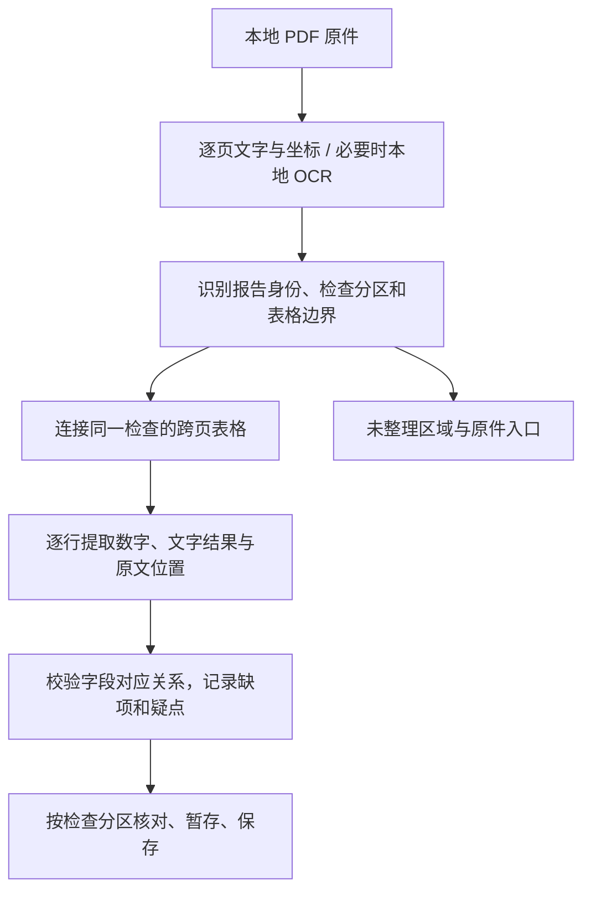

# 个人健康记录 App · 报告解析增强方案 v0.1

日期：2026 年 10 月 23 日  
状态：原设计与验收要求留档。A＋B＋C 已形成第一轮实现，严格验收仍有缺口；D 未实施。当前实现以[技术方案](技术方案.md)、[状态清单](docs/当前状态与待办.md)和[实施记录](docs/复杂报告解析实施记录.md)为准。  
关联：[当前技术方案](技术方案.md)、[多版式 OCR 测试](docs/多版式OCR测试.md)。

## 1. 要达到什么效果

**让一份多页体检 PDF 自动整理成按检查项目分区的记录，支持跨页表格、少量项目和文字结果。继续使用本地提取与本地 OCR。**

用户导入后，应看到“血常规、实验室检查、尿常规、眼压”等检查分区，而不是每页一条“待整理报告”。每项结果都可以定位原件，未整理的部分有明确入口。分析范围是提取和组织报告中的事实；本轮不增加疾病判断、疗效评价或治疗建议。

建议先交付“复杂报告中的检验表格”这一完整能力。医生结论原文归档、混合页面的局部 OCR 放到后续阶段；影像本身保留查看，不尝试从超声或心电图图像作医学解读。

## 2. 实施前基线（保留原设计依据）

增强前，对用户提供的 40 页、约 15 MB 体检报告进行 iOS 隔离测试：40 页均选择文字层提取，当时结构化指标为 0。**这是实施前基线，不是当前结果。** 现已在两端形成 7 个分区、115 项；包含原报告标记的完整行匹配为 111/115，4 个图形箭头仍缺失。当前结论见[实施记录](docs/复杂报告解析实施记录.md)和[状态清单](docs/当前状态与待办.md)。

测试证据保存在本机忽略目录 `tmp/complex-report-20261023/`，包括 `current-ios.xcresult`、`native.json`、`parsed.json`、`summary.json`。下文只描述结构，不复制姓名、证件、具体检查结果或诊断内容。

| 实际结构 | 实施前限制 | 原设计要补的能力 |
| --- | --- | --- |
| 血常规表头在第 10 页，数据在第 11 页 | `parsePages` 各页独立处理；表头没有数据也被丢弃 | 保存表头上下文，连接相邻页的同一张表 |
| 第 13–15 页实验室表格连续排版 | 后续页没有重复表头 | 以整张检查表为单位解析和核对 |
| 数字与“阴性”等文字结果混排 | 数字和数值参考范围的占比决定整表是否通过 | 逐行识别结果类型，保留符合结构的文字结果 |
| 眼压两项、呼气检查一项 | 统一要求至少三行 | 根据表头、分区和单元格位置接纳小表 |
| 同页有几个检查分区，夹着小结、页脚 | 仅依赖部分表头定位，缺少完整分区边界 | 分开表格、说明、结论及页眉页脚 |
| 一份 PDF 有几十页 | 未支持页会逐页生成空的待整理记录 | 文档下按检查分区组织，并汇总未整理区域 |

当前 `Observation.rawValue` 已能保存字符串，趋势计算也会跳过不可解析为数字的值；本轮主要补自动提取、结果类型和对应核对逻辑，不需另做一套文字结果数据库。

## 3. 用户会看到的变化

1. 导入后先看到一份报告，内部按原文检查标题列出分区、项目数和待核对项。跨页的血常规只显示一个分区。
2. 进入分区沿用现有连续列表和直接勾选。原图仍按实际页展示，换页会换原图；不会把两页拼成一张失真的核对图片。
3. 数值结果展示数值、单位和参考范围；“阴性”“弱阳性”等按原文展示，不出现数值范围横条，也不转换成 0 或 1。
4. 只有明确的识别疑点要求逐项处理；其余项目在保存该分区时统一确认。用户可以暂存，随后继续其他分区。
5. 显示“已整理项目”“待核对项目”和“未整理内容”。封面、目录、科普页仍在原件中，不制造几十条空记录；无法确定用途的区域显示“未整理”，不能悄悄隐藏。
6. 新解析结果仍需符合现有指标映射、标本、方法和日期要求，才可进入趋势。支持提取更多项目不等于这些项目已经能跨医院比较。

产品界面只出现“血常规”“尚未整理”“请对照原报告确认”等用户能理解的内容；表头继承、解析器版本和内部评分只用于实现与调试。

## 4. 技术处理链路

已验证的浙一解析保留优先级。新流程处理通用报告；两种解析结果不能叠加生成重复指标。一个区域只能由一个选定解析器产出正式候选，其余读取作为校验依据。

### 4.1 先识别区域，再处理区域内的行列

- 原生层继续提供字符／词块坐标，不把整页先压成没有位置的长字符串。
- 综合检查标题、表头、列位置、行间距、分隔空白和“小结／初步意见”等结束标志确定区域。
- 先读取页眉中的身份信息，再识别重复页眉、页脚与水印；重复出现的正文项目不能仅因“重复”被过滤。
- 支持同页上下多表、左右双表、名称换行和独立箭头列。名称折行只在同一项目列和同一行区域内合并，不能跨进相邻结果格。
- 初版使用已有文字坐标完成分区。若某类版式必须依赖表格线或图像位置，先记入未支持清单，后续扩展原生布局信息，不虚构已有 API。

### 4.2 跨页连接要有证据

表头即使出现在页底且没有数据，也保存为“待续表头”。后一页只有满足以下条件才续接：

- 页码相邻，位于同一输入文件；当前检查尚未遇到结束标志。
- 已读到的患者、报告编号和检查日期没有冲突；缺失身份信息只能在同一已确定的报告分段内继承，缺失本身不是匹配证据。
- 归一化后的项目、结果、单位等列位置一致，后续行符合对应列的结构。阈值由标注样本与反例校准，不绑定某家医院的固定横坐标。
- 没有出现新的检查标题、不同表头或另一份报告的起始标志；如果存在多个可能的前表，停止自动连接。

同一表续到下一页时继续保留上下文，直到明确结束。不能越过中间的另一项检查去找更远的页面。遇到不同人员时停止合并并提示归属核对，不自动创建或切换成员。

每个结果仍保留所在页和行区域；另存采用的表头页和区域。以后排查错误时能区分“字读错了”和“列接错了”。

### 4.3 逐行识别结果，不以整张表的数字比例决定去留

| 结果类别 | 示例表达 | 保存和展示 |
| --- | --- | --- |
| 精确数值 | `0`、`5.4` | 保留原始表达和数值；只有可比性规则通过后参加趋势 |
| 带限定符的数值 | `<5`、`≥100` | 保留运算符，不作为精确值计算差值 |
| 定性结果 | 阴性、阳性、弱阳性、`±` | 原样保存，可在原文支持时标注类别，不数值化 |
| 等级或其他文字 | `Ⅱ度`、未见异常 | 保存完整文字；不生成数值范围图或医学解释 |
| 空白／读取不清 | 空单元格、相互冲突的读数 | 留空或保留候选，标记待核对，不补 0 |

参考范围同样允许数字、文字、单侧界限或原文缺省。无量纲项目的空单位不自动视为错误；无法区分“原件为空”和“漏读”时提示核对。

表格成立依据是标题、列关系和行结构。某行是文字结果，不应导致同表其他数值行被丢弃；某个单元格模糊，也不应撤销整张已经定位的表。

### 4.4 小表格单独校验

一项或两项检查也可以被识别，但不能简单把全局最少行数改成 1。

接受小表需要明确的项目／结果表头、局部检查分区、对齐的单元格和可定位的结果来源；单位和参考范围按原文是否存在处理。正文里的孤立数字、健康建议中的数值和“参考值介绍表”不能作为用户实测结果。

没有完整表头的零散项目先保留原件和手工入口。本轮不为扩大识别数量而猜字段。

### 4.5 日期、身份和重复内容

- 体检日期、采样日期、报告日期分开记录；PDF 创建时间或导入时间不能代替检查日期。
- 同一体检文件内的不同检查若有各自日期，以局部明确标注为准。封面日期只能作为来源明确的体检上下文，不填成采样日期。
- 指标正文与汇总页重复出现时，以原始检验区域为主要来源；缺乏报告编号、检查分区和来源位置等证据时保留为疑似重复，不能仅凭名称与数值删除一条。
- 原报告箭头作为原文标记保留，与识别疑点、相对上次的变化分开。

## 5. 数据与现有实现如何衔接

以下为原设计目标；本轮落地范围、旧记录处理策略和验证结果以[实施记录](docs/复杂报告解析实施记录.md)为准。

| 对象 | 拟补信息 | 作用 |
| --- | --- | --- |
| 文档 `DocumentRecord` | 检查分区清单、页面／区域处理状态、解析版本 | 整份 PDF 的入口与未整理内容，不逐页制造空报告 |
| 报告 `Report` | `sourcePages`、稳定的分区标识、原文标题、分区来源 | 一份检查可覆盖多页；沿用现有确认状态、成员及就诊关联 |
| 项目 `Observation` | 结果类型、表头来源；必要时多个原文区域 | 数字／文字正确展示，跨行跨页定位有依据 |
| 重新解析草稿 | 本次候选、原记录对应关系、增删／修改差异 | 用户保存前保持原确认记录；避免重复和丢失修改 |

继续以 `rawValue`、`originalValue`、`unit`、`reference` 保存原文。一个新结果类型字段不应改变原始表达；原文缺失和解析器未读清要有不同状态。

主要改动位置：

- `src/parser/`：在现有入口上增加整份文档的分区与上下文，再调用单表解析；布局、续页判断、结果分类独立为纯函数，便于两端共用和测试。
- `src/services/import.ts`：从“每页生成一条 Report”调整为“按确定的检查分区生成 Report”。不明确的区域挂在文档下，仍可查看、补录。
- `src/services/extract.ts`：首轮复用当前提取器；局部补读仍只针对明确的缺失格，不用补读猜整张表结构。
- `src/domain/types.ts` 和现有核对／详情组件：支持多页来源和结果类型，按检查分区导航；分组仍不能跨实际原图页。
- `src/db/`：现有对象主要存 JSON，可增可选字段，但多页记录的重新解析和关联事务需要专项验证；若新增表或改变持久化语义，明确升级 schema 版本和读取兼容方式。

旧记录缺少新字段时按旧方式显示；不能把所有旧 `rawValue` 默认标成数值。根据已有表达作显示兼容，不改用户确认内容。

### 5.1 重新识别与迁移

实施前 `reparseReport` 只把一个来源页交给解析器；当前实现已重建整份文档上下文。以下保留原设计要求：重建文档上下文后定位原检查分区，或者读取该分区的完整来源页及必要表头上下文。

若一次重新识别涉及把几条旧的单页记录合成一份多页检查，展示对应关系，明确保存后才在同一事务内处理记录、修订历史和就诊关联。无法可靠对应时保留独立候选，不能自动替换旧记录。

旧值、用户修正、已核对状态不直接继承到不同的候选项目；一项只有身份和内容都能可靠对应时才考虑保留确认。取消、保存失败和 App 中断均保留原记录。多页记录写入后的降级限制须在实施时验证，不能通过清空数据库实现回退。

### 5.2 存储与性能

本轮持久化分区、结果、原文位置、处理状态和解析版本。详情和趋势继续直接读本地数据库，不重新读取 PDF。

重新识别是用户主动触发的任务。第一阶段可以重新提取一次完整文件来恢复上下文；先实测是否需要缓存原始文字坐标，暂不增加大份原始 OCR 输出的长期缓存。若后续确有收益，再以文件指纹、平台、系统／提取器版本和页码建立受保护且可失效的缓存。

保留当前 20 MB、50 页输入限制。现有原生提取仍是整份调用：提取已成功时支持部分区域解析；若原生提取整份失败，仍走现有原件保留与重试流程，不宣称本轮已经做到按页断点恢复。

## 6. 分阶段实施

| 阶段 | 交付物 | 验收后再进入下一步 |
| --- | --- | --- |
| A：建立完整基准 | 对 40 页报告标注检查分区、数值／文字结果、单位、范围、来源和不在范围内的内容 | 人工清单固定后再调规则；现有 0 项结果可复现 |
| B：增强通用解析 | 分区、跨页连接、小表格、数字与文字结果；先用离线运行器输出对照清单 | 确认提取字段和错漏项，不先写入用户病历 |
| C：接入 App | 按检查分区核对和保存、多页来源、文字结果、未整理入口、重新识别兼容 | 两端完整流程通过，再交付可体验版本 |
| D：按新样本补能力 | 明确标签下的医生结论原文、混合页局部 OCR、按页提取和恢复 | 每项单独验证，不阻塞 B＋C 的检验表格交付 |

**实施进展：A＋B＋C 已接入并完成首轮验证，但尚未全部验收；D 尚未实施。**

原设计建议第一轮只安排 A＋B＋C。 A 是测试基础，B 是核心解析工作，C 是可用产品闭环。不能只让本机脚本解析成功，就当作手机已支持。暂不接云端 OCR、大模型或新收费功能。

阶段 D 的混合页面需要特别处理“页眉有文字、正文是扫描图”的情况：不能仅凭全页字符数就跳过正文 OCR，也不能因规则不支持就对所有文字页重复 OCR。先取得图像区域或其他可靠的内容覆盖证据，再对有必要的区域补读，保留各字段来源和冲突记录；现有只识别小数值格的 API 不能直接冒充任意正文区域识别接口。

医生结论仅按明确的检查标题和“检查所见／结论”等区域保留原文及页码。报告内的科普、推广内容和建议不能被当作新检验结果，也不通过规则改写成诊断或病情结论。

## 7. 如何证明改好了

### 7.1 样本与比较口径

- 40 页体检报告作为开发基准；至少覆盖第 10–11 页续表、第 13–15 页连续实验室表、单项／双项小表、定性结果和同页多分区。完整期望项数以人工标注清单为准，不先虚构“应识别多少项”。
- 原两份浙一血常规、当前已适配的生化样本、9 份公开样例共同回归。原先未读对的 OCR 项仍记录实际差异；新增结构规则不应造成原本正确字段退步。
- 另准备至少 3 份、来自至少 2 个来源的多页报告作为初步留出验证。未用于调参时才称留出；如果拿来修改规则，需另换样本。未收集到时如实说明泛化验证未完成。
- 真实文件、提取输出和人工标注只在忽略的私有目录；可公开测试使用合成版式，不把用户报告、可识别身份或诊断内容打进 App。

分别统计每个平台的以下结果：

| 指标 | 计算与用途 |
| --- | --- |
| 项目覆盖 | 正确找到的原文项目数 ÷ 人工标注的目标项目数；漏项单列 |
| 字段匹配 | 分别核对名称、结果／运算符、单位、参考范围、箭头和结果类型 |
| 完整行匹配 | 所有要求字段、来源行与所属检查都正确的项目数，不以“数字读对”代替 |
| 多出项与误连接 | 无原文依据的项目、错人、错检查、跨页串行、重复项目分别列出 |
| 未整理情况 | 按分区和区域列明未处理内容，不能用封面或科普页充当成功分母 |
| 核对成本 | 需修改项、必须单独确认项、操作次数和完成时间 |
| 性能 | 原生提取、结构解析、原图预览分别计时；测内存和中断恢复 |

### 7.2 第一轮验收要求

1. 在这份文字层清晰的开发报告上，已确定范围内的标注项目须逐项核对通过；漏项、错值或错来源都算未达标，不能用“已打待核对标记”替代正确性验收。事先排除的图片／文本区域单独列明。
2. 血常规等跨页检查合成正确分区；封面、科普和未支持区域不会生成空指标或几十条空报告。
3. 反例覆盖不同患者、不同日期／编号、突然换表、同名不同检查、跨页名称折行及上下栏相近等情况；出现身份冲突或不唯一连接时必须停止自动合并。
4. 单项检查、两项检查、数字 0、空白、负数、限定符、阴性／弱阳性、等级和缺单位均有独立用例；参考说明里的数值不能被提取成实测指标。
5. 原两份血常规的两端 45 项完整字段回归通过；其余现有样本逐项与当前基线比较，不退步。两个系统分别跑实际原生输出，不能只共用一份 OCR JSON 就声称两端通过。
6. iOS 和 Android 完成导入 → 分区核对 → 暂存／重启 → 保存 → 查看原件 → 重新识别取消／保存的流程。数据库迁移和失败回退使用测试副本验证，不操作用户已确认病历。
7. 真机 Release 再验证离线、长文档耗时、峰值内存及中途退后台；模拟器读取此 PDF 的耗时不能当作手机性能承诺。

## 8. 规模和取舍

这属于一次中等规模的解析流程升级：核心是共用 TypeScript 规则，但同时涉及多页报告模型、核对入口和重新识别。A＋B 可以先独立验证；C 的旧数据兼容是交付前必要工作。

优先收益来自跨页表格和按行分类，能惠及其他结构相近的报告。实际泛化范围由留出样本决定。局部 OCR、医生结论和趋势映射各自有独立问题，分阶段验证；不把它们混在第一轮里承诺一次全部解决。
