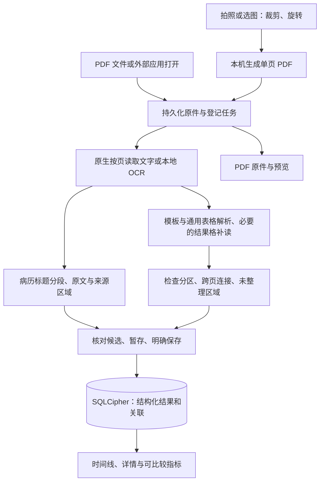

# 健康小本 · 技术方案

核对日期：2026-10-25（北京时间）。本文对应当前代码；未来设计单独标为待办。App 版本 0.1.0，数据库 schema 6，检验文档解析版本 3，病历分段结果版本 1；这些版本号分别管理。

本次同步病历小数点处理、展示排版、弹层动画及既有验证范围；未新增原生构建或设备验收。

[产品方案](产品方案.md) · [当前状态与待办](docs/当前状态与待办.md) · [本地开发与测试](docs/本地开发与测试.md)

## 1. 技术栈与结构

使用 React Native 0.81.5、React 19.1.0、TypeScript、Expo SDK 54（expo 54.0.38）。Expo 管理工程和本地开发构建；使用自定义原生模块，需要 Development Build，普通 Expo Go 不能运行。

Node 由 `.nvmrc` 固定为 22.22.0，这是已验证环境；升级 Node 需另做依赖和构建验证。Android 使用 JDK 17；本机已验证 Xcode 16.4、CocoaPods 1.16.2、Android SDK 36，NDK 主版本 27.1，SQLCipher 依赖另用 27.0。

| 目录／文件                        | 当前职责                                                                   |
| --------------------------------- | -------------------------------------------------------------------------- |
| `app/`                            | Expo Router 页面：记录、指标、设置、成员、照片、报告、整份文档、原件、就诊 |
| `src/state.tsx`                   | 本地数据加载、当前成员、前台恢复、外部文件接收触发及导入后导航             |
| `src/parser/`                     | 浙一适配、通用表格、整份文档分区、跨页上下文、日期提取                     |
| `src/domain/`                     | 模型、成员归属、核对分组、参考范围和可比性规则                             |
| `src/db/`                         | SQLCipher、迁移、事务、原件引用、修订和就诊关联                            |
| `src/services/`                   | 导入队列、局部补读、原件预览缓存、日期补齐、可选统计                       |
| `modules/local-pdf/`              | iOS Swift／Android Kotlin：PDF、OCR、图片转换、渲染、哈希、外部接收        |
| `app.config.ts`、`plugins/`       | 可再生成的系统配置；`ios/`、`android/` 为原生工程产物                      |
| `services/analytics/`             | Node 开发用统计接收端及独立 SQLite                                         |
| `tests/`、`.maestro/`、`scripts/` | 规则／组件／数据库测试、原生测试、模拟器流程和样本比较工具                 |
| `prototypes/`                     | 设计探索代码，不能作为 App 已交付能力的证据                                |

## 2. 当前处理链路

当前链路不包含备份模块、医院 API、账号服务、Share Extension、云端识别或 LLM。统计是独立的可选数据流，不接收报告对象。

## 3. 文件接收、去重与恢复

`src/services/import.ts` 串行处理导入：校验文件 → 计算哈希 → 按成员去重 → 复制到持久目录 → 登记 `queued` → `extracting` → `ready`／`failed`。数据库登记发生在提取前；已登记原件在解析失败时保留，供重试或手动整理。

- 同一成员用内容哈希去重；不同成员分别存储。同名或不同文件的相似报告没有自动去重机制。
- 文件接收时捕获成员，外部队列的成员绑定按 URI 持久化，避免任务等待时被新选择的成员接管。
- `recoverImports()` 恢复 `queued`／`extracting` 文档，重新执行提取。它不是按页断点续传，也不是 OS 持续后台任务。
- 完成外部导入后通过 `importedDestination()` 打开就诊、报告或多页文档；任务完成前切换成员时不跳到原成员详情。

App 内文件选择器通过 `importPickedPdf()` 管理 `cache/DocumentPicker` 的临时副本：成功、重复或失败后都尝试清理本次副本，外部原文件不参与清理。已登记的持久原件在 OCR 失败后继续保留；登记前失败需要重新选择文件。清理失败不改变导入结果，下次前台恢复会尝试移除超过 24 小时的遗留选择器缓存；选择器打开期间及当前导入使用中的文件均受保护。

### iOS

`CFBundleDocumentTypes` 声明 PDF，`LSSupportsOpeningDocumentsInPlace` 支持原位打开。`LocalPdfAppDelegate` 处理启动 URL 与 `openURL`。

`IncomingPdfInbox` 同时扫描 `Documents/Inbox` 和 `Application Support/incoming`。外部路径采用安全作用域和 `NSFileCoordinator` 读取；外部副本先写 `.pending`，保护完成后原子改名。已在受管收件目录中的文件不重复复制。

原件准备好后发出 `onIncomingFile`，JS 先订阅再扫描，同时保留启动／前台恢复机制。接收失败只暂存通用提示，不保存医疗内容到诊断日志。收件副本只有在持久原件已保存后才删除，删除范围受目录、文件类型和符号链接校验限制。

**未实现 iOS Share Extension 或 App Group。** 系统“其他应用打开”已能接收 PDF；不能将它与分享扩展混称，也不能把微信成功等同于所有来源应用均已验证。

### Android

声明 PDF 的 `ACTION_VIEW`／`ACTION_SEND`，通过 ContentResolver 将 URI 内容复制到内部收件目录。`OnNewIntent` 接收新请求，启动扫描处理 Activity 的初始 Intent，随后走共用导入队列。Android 外部来源真机验收独立记录，不能套用 iPhone 微信结论。

## 4. 本地提取与字段解析

| 层             | iOS                    | Android                                                          |
| -------------- | ---------------------- | ---------------------------------------------------------------- |
| PDF 文字与位置 | 系统 PDFKit            | `io.legere:pdfiumandroid:1.0.32`                                 |
| OCR            | 系统 Vision            | 内置 `com.google.mlkit:text-recognition-chinese:16.0.1` 中文模型 |
| 图片转换       | UIKit 生成本地单页 PDF | PdfDocument 生成本地单页 PDF                                     |
| 图片预览       | PDFKit 原页／区域渲染  | 原生 PDF 区域渲染                                                |

逐页评估可用文字、乱码及旋转等条件，必要时 OCR。主结果 `spans`、辅助数字结果 `numericSpans`、另一尺寸的中文结果 `tableSpans` 分开返回并保留归一化坐标。不同读数用于发现冲突，不以参考范围猜测正确数字。

`src/services/extract.ts` 使用整份文档建立跨页表头上下文，再筛选 OCR 页上位置明确的缺失结果格，去重并限制为最多 12 格局部补读，返回 `cellSpans`。分区解析器只在同页、同行、同结果列有单一有效数值且原结果为空时补入，包括实际识别出的 `0`，并保留逐项核对提示。已有值不被补读覆盖；冲突或多候选仍需人工核对。补读失败保留初次结果；空白不能自动补零。它不是任意正文区域 OCR，也不能补齐所有混合页面的扫描正文。

统一入口 `parseRecords()` 先识别独立病历页；其余页面通过 `parseDocument()` 调用 `parsePages()`：

1. 已验证的浙一适配保留优先级，合成测试格式单独识别。
2. 通用分区解析器读取检查标题、列位置、表头和行关系，支持同页多表、折行名称、一两项小表及数值／文字混排。
3. 满足相邻页、身份／日期／编号及列位置等约束时继承表头；冲突或连接不唯一时停止续接。
4. 旧通用表格回退仅移除与新分区重叠的行，避免重复项目，也避免按整页误丢另一张表。

打印超声页在检验表格前由 `src/parser/ultrasound.ts` 按报告标题、唯一患者身份及所见／提示段落组合识别；命中页不再交给表格回退，防止把尺寸或分级当作检验数值。`Report.reportType = 'imaging'` 沿用 JSON 数据存储，段落作为 `resultKind: 'text'` 的项目保留原始文字与来源区域。核对页使用 `NarrativeObservation` 展示全文、编辑和原件预览；`buildMetricData` 及缺日期趋势提示明确排除 imaging。无需数据库 schema 或原生模块升级。

显式检查日期优先，缺少时使用报告日期并设 `dateKind: 'report'`；出生、打印及手写随访日期不兜底。缩进明显偏离段落标题的行不拼入段落，对齐容差不随旁行高度扩大，仍纳入来源区域并提示核对；这只是版式过滤，不能保证准确区分手写和打印。保留 OCR 原读数；超声正文只对相邻同段、行末与次行开头位置匹配且各次读数无数字冲突的断行，用另一份识别结果中实际存在的小数点恢复显示，不依据医学常识补点。文档解析版本升至 4；单份重识别保持原记录 ID 与成员，整份候选保存同时更新文档分类，均不自动保存。详见[超声报告实施](docs/超声报告原文识别-2026-10-27.md)。

通用表格的一至两项短表，在完整列位置和每项实际数值／参考范围之外，还需明确检验／检测报告标题、姓名和有效采集日期，避免把零散文字当作结果。方法列独立隔开；参考范围与相隔较远的标记分开读取，未知标记保留核对提示，不拼接到范围下限。已知单位尾部多余点的规范化保留原单位与核对提示。详见[单项检验报告修复](docs/单项检验报告识别修复-2026-10-26.md)。
5. 输出分区清单、来源页和二维未整理区域。未整理区域是保守覆盖信息，不表示已准确分类所有段落或图像。

分区和旧通用表格在生成项目时共用行政信息过滤规则，排除可辨认的机构名称、服务热线、收费说明及页码；不通过整页底部裁切或医院名称白名单来实现。旧通用表格中的空数值行还需单位或参考范围证据，保留真实的空值、阴性参考和未知但具有单位结构的内容供核对。修复只影响新解析，不改写已保存结果；验证与历史记录处理边界见[页脚误提取修复](docs/报告页脚误提取修复-2026-10-25.md)。

门诊病历由 `src/parser/visit.ts` 按显式标题分段。两端 OCR 新增 `readingLines`，保留原生阅读顺序和整行坐标，既有 `spans` 与检验拼行规则不变；iOS 文字页也返回 PDFKit 行结构，Android 文字页回退使用文字位置。处理拆开的“主／诉”等标题，医院／姓名／科室／就诊日期只取正文前的页眉；无日期、非法日期或多个相冲突日期留空。正文不生成新诊断或剂量。

分段前调用 `src/parser/visit-decimals.ts`：仅对 OCR 页面上几何位置符合同一印刷行的相邻数字片段，利用已有 `numericSpans`／`tableSpans` 查找同位置的小数证据。数字一致、有明确小数且无冲突时才合并断行并恢复小数点；不按医学阈值补点，不增加整页 OCR 次数。没有证据时保留原读数供核对。该规则作用于重新解析，不自动迁移历史就诊正文；实测范围见[病历实施记录](docs/门诊病历实施记录.md)。

病历保留三层内容：`Visit.original.lines` 是未被上述修复改写的原始行；`Visit.original.sections` 是初次整理后的段落及区域；`Visit.sections` 是当前可编辑内容，初始取自整理结果。后续保存不覆盖既存 `original`。导入时将病历和检验候选与文档状态一并提交；没有确定类型的文档保持 `unknown`，进入选择用途／手动整理页，不创建空的伪检验记录。未完成导入、重复导入和外部收件沿用同一记录路由。用户明确选择“按病历整理”时才对未知原件尝试分段；已有病历草稿直接复用。

一张照片对应一份病历；多页文件按具有独立正文标题的页面建立病历候选，其余页可查看原件或手动整理。当前不自动合并跨页病历，不按日期自动关联，不自动修正没有标题的长段落；同一页同时有病历正文与检验表格时优先病历，其表格可从原页补录。病历的主动重新识别候选尚未提供。

当前输入限制：PDF ≤20 MB、1–50 页；原生提取包含约 120 秒预算检查、文本／块数量限制。预算检查不等于可立即取消的硬超时，尚无逐页落盘与恢复。一般查看记录只读取结构化数据；用户主动重识别时重新提取原件。

## 5. 数据模型与兼容

| 对象             | 当前持久化内容                                                                                              |
| ---------------- | ----------------------------------------------------------------------------------------------------------- |
| `Member`         | 称呼、报告姓名、出生日期、显示色及标识                                                                      |
| `DocumentRecord` | 成员、哈希、原件 URI、来源类型、页数、处理状态；`parsing` 保存解析版本、分区和未整理区域                    |
| `Report`         | 成员、文档、标题、患者、日期及含义、确认状态、模板；`sourcePages`、`sectionKey` 保留多页来源                |
| `Observation`    | 原始和当前值、名称、单位、范围、可比性映射、原报告标记、疑点及核对状态；行／值／表头位置与结果类别          |
| `Visit`          | 成员、日期、标题、医院、科室、患者、核对状态、备注、关联检验；原件和来源页、原始 OCR 与段落区域、独立编辑值 |

实际表为 `documents`、`reports`、`observations`、`revisions`、`visits`、`visit_reports`、`settings`、`members`、`pending_file_deletions`。版本通过 `PRAGMA user_version` 管理，**没有独立 `schema_migrations` 表**。

当前 schema 为 6：2026-10-23 审计修复增加 `pending_file_deletions`，同期门诊病历开发增加 `visits.document_id` 原件关联。旧单成员资料迁入“我”，既有原件、指标、修订和就诊关联保留。读写访问串行，保存与关系变更使用事务。应用更新后的沙盒 URI 通过受管原件位置解析，避免沿用失效的绝对容器路径。

`RecordsProvider` 按当前成员过滤报告、原件和就诊；`app/visit.tsx` 只从当前成员集合查找记录，并以成员与记录 ID 重建编辑状态。数据库同时校验病历原件、就诊和关联检验归属。同一文件跨成员导入会各自保存，不按正文相同自动合并。成员切换及刷新回归见 `tests/components/visit-members.test.tsx`。

只支持较早 schema 的旧安装包不能读取 schema 6。Debug／Release 是构建模式，不决定数据库版本；切换模式可以保留同一 App 的数据，但安装旧业务代码仍可能构成不兼容降级。不得以清空用户数据解决回退问题。

删除原件时，在移除数据库记录的同一事务中登记待清理任务，再清理 PDF 和预览；两者都成功才移除任务。失败任务在下次启动、回到前台或“重新读取”时重试，不阻断其他资料展示。文件路径按当前沙盒和受校验的文档 ID 重建。单条记录删除与仅原件删除沿用原有保护；整份删除独立使用 `getDocumentDeletionScope()`／`deleteWholeDocument()`：读取当前成员的实际范围，在事务内重新验证归属及包含记录、结果、修订和关联的快照；有变化先返回新范围供再次确认。事务内删除同源就诊、检验及文档，外键级联清除结果、修订与关联，不级联删除独立关联记录。逻辑删除成功后，文件清理失败返回 `cleanupPending`，不伪报事务失败。导入进度仅更新已存在的文档，`commitImport()` 也先检查原件仍存在，包括零候选结果，避免删除后的迟到结果重新创建记录。此前已丢失数据库路径的历史孤立原件不在此轮自动清理范围内。

整份删除的交互由 `DocumentDelete` 实现，整份资料页始终提供入口，PDF／照片原件页提供“管理报告”。确认弹层从数据库读取数量，固定遮罩渐变、面板独立移动，遵循减少动态效果，取消优先获得读屏焦点；提交中禁止重复确认与关闭。确认成功后刷新记录并回列表。详情见[整份报告删除设计与实施](docs/整份报告删除设计-2026-10-25.md)。本轮无 schema 或原生模块变更。

## 6. 核对、日期、趋势与重新识别

- 就诊的阅读态由 `VisitReader` 展示，不挂载 `SourcePreview`，单一原件入口直接打开 PDF／照片原件，并保留多页文件的来源页。`app/visit.tsx` 保留核对编辑态；确认保存后回到阅读态。备注与关联检验在原生弹层中暂存修改，只在 `saveVisit` 成功后更新详情；写入沿用成员与原件校验，不改变病历正文、原始 OCR 或确认状态。旧手动记录兼容，不需要数据库迁移。详见[就诊详情设计与实施](docs/就诊详情阅读态设计-2026-10-24.md)。
- `formatExaminationText()` 只作用于详情与核对页的体格检查阅读文字：统一中文句读、横向空白和常用单位间距，按原文标题分段；保留小数、数字千分位、时间／比例冒号及单位拼写。输入框、保存数据、其他正文段落不经过该函数，已有记录打开即生效，无需 OCR 或迁移。它与解析阶段的小数点修复职责不同。
- 备注／关联弹层使用 `Modal animationType="none"`，全屏遮罩只做透明度变化；面板在展示、测量后独立位移，退场完成后卸载。键盘避让仅作用于面板，遵循系统减少动态效果；保存中禁止关闭，退场中阻止重复操作。视觉与键盘真机验收仍待补齐。
- 核对按原图顺序每组最多 5 项，并按实际页／栏拆组；具体疑点直接勾选，编辑后重新标记。通用照片核对提示不等于每项都必须单独确认。报告确认前不进入正式趋势。
- 分组浏览由 `useReviewGroupNavigation` 协调：保留当前组到滚动结束后再替换，等键盘收起，每次只发出一条滚动指令；拖动、离页或成员变化取消未完成请求，遵循减少动态效果。`useReviewPreviews` 保留当前／相邻组的本地图片准备任务；`SourcePreview` 用准备好的图片与测量宽度直接设定高度。详见[切组抖动修复](docs/核对切组抖动复现-2026-10-26.md)。
- `pending` 按整份当前检查的 `needsIndividualReview` 计算，不按屏幕上这一组计算。存在结果且处于核对模式时，用已有 `Screen.fixedFooter` 显示唯一主操作，底部留出安全区；顶部只统计进度，组下保留独立翻组入口。有疑点时“去核对”复用 `jumpToRow` 定位并展开第一个待核对项目；`pending.length === 0` 时显示“将保存全部 N 项结果”和“完成核对”，无需位于最后一组。分组过渡不禁用或淡化底部主操作；点击主操作先取消待完成的切组请求，避免迟到的原图／滚动回调覆盖核对定位。保存仍使用 `persist('confirmed')` 和同步防重锁，校验姓名、有效日期与身份归属；信息问题展开元数据并清除组跳转目标、回到顶部。没有自动批量解除疑点或自动提交，未显示组的数值、单位等沿用完整草稿保存。
- 确认保存后保留当前核对布局和分组，等待 `refresh()` 再直接返回；多页用 `dismissTo` 回已有整份报告页，单页沿用回首页。导航退场期间保持 `busy` 和防重锁，不先渲染详情、不重新启用确认按钮；失败解除锁以便重试。暂存仍留在当前详情页。详见[完成核对返回修复](docs/报告核对完成返回修复-2026-10-26.md)。
- `resultKind` 区分精确数值、带限定符数值、定性、文字和缺失。图形箭头未读到时使用 `markerStatus: unavailable` 提示，不从结果反推出原报告箭头。
- `zheyi-date.ts` 保留明确采样／报告日期的来源；可靠的已验证页眉日期标记 `dateSource: header`。非法、冲突、出生或打印日期不强行回填。
- `repair-report-dates.ts` 是普通查看不重复 OCR 的一个例外：针对日期为空的已知浙一旧记录作一次成功提取尝试，写入前重核元数据。只补日期和相应提示；失败可后续重试，多页分区不套用这个单页修复。
- `buildMetricData()` 从已确认报告生成 `{ groups, untrended }`；`groups` 为数值 `MetricSeries` 与文字 `TextMetricSeries` 的联合类型。文字点只保存原结果，不伪造数值；`buildSeries()` 保留只返回数值序列的兼容行为。两类均需有效日期、患者、成员且无未解决疑点；缺条件、空值、限定值和无法识别的数值仍返回原结果及原因。已确认但未匹配的精确数值按来源独立成组，保留参考范围展示。
- 文字类别根据当前 `rawValue` 判定，兼容旧记录无 `resultKind` 或用户编辑后旧标签未变的情况。普通文字、阴阳性和加号等定性标记形成历史；数字格式错误或超出数值边界不伪装为文字。按成员、原检查标题、原项目名称、代码及一致的单位／标本／方法生成文字组键，只统一字形和空白，不推测同义项目。泛化报告／页码标题不足以确定类别时按来源单独保留；数值与文字结果类型不混成同一序列。详见[文字历史实施](docs/文字结果历次记录-2026-10-26.md)。
- `metric-matching.ts` 使用明确别名／等价单位白名单及报告类别证据匹配常见血常规、生化、一般检查。常见项目按成员、规范项目、等价单位、具体标本及方法分组；未注明条件保持独立标记，与已明确的条件分开。未知条件只在有常规类别证据的同类项目内对照，并在展开时提示。既有其他受控代码保留严格分组，已知浙一代码不能绕过单位与上下文校验。无需数据库迁移，不回写推测字段；原名称／单位／报告标题随每个历史点保留。详见[方案与验证](docs/体检指标与历史趋势方案-2026-10-26.md)。
- “暂未进入趋势”保留限定值及信息不完整等结果，正常文字结果进入同一个紧凑指标列表，展开只显示历次原结果。`metricOverview()` 的数值范围计数和筛选跳过文字组，全部列表仍包含文字；文字不调用 `MetricTrend` 或 `delta`，不显示高低状态或缺参考范围提示。只有文字时隐藏数值统计。指标列表继续显示数值匹配条件和来源；单侧参考范围可用于数值状态，报告详情横条与统一趋势参考带另有更严格条件。
- 单分区重新识别先重建整份上下文，候选保存前不改旧记录；保存使用现有事务、修订和就诊关系。
- 整份重识别采用明确的追加保存，保留旧分区及人工修正；没有自动合并旧单页记录的向导，可能产生重复分区。

2026-10-26 界面表述调整：内部仍按 section／Report 保存，面向用户使用“X 类检查”“检查结果”“另存新识别结果”，不再展示“检查分区”。仅更新展示及错误提示，不改分组、识别、保存逻辑或已有数据。

整份报告与检验详情统一使用 `BackLink`，先检查 `router.canGoBack()`，有历史则返回，无历史则 `replace('/')`；点击区域至少 44 点，保存期间禁用。多页检查确认保存后使用 `dismissTo('/document/:id')` 回到已有整份报告，避免 `replace` 在原目录上方叠出第二份目录；没有对应历史页面时由路由器替换到目标页面。

同日增加同原件姓名补全：`DocumentPatientFill` 在整份报告与核对页内展开输入，不使用弹层。`fillDocumentPatient` 在写入队列的一次事务中重读原件、归属和报告，检查姓名冲突，仅修改同一 `documentId`／`memberId` 下 `review` 状态且姓名为空的元数据，并写入修订历史；结果行、状态、原件和就诊关联不变。清除失效的姓名缺失提示和旧身份确认，不自动通过身份核对；后续保存仍使用原有 `needsIdentityReview` 校验。重复提交防重，写入失败整批回滚；页面刷新仅补入仍为空的姓名，不覆盖正在编辑的数值或已输入姓名。无 schema、原生模块或自动迁移改动。

原图 PNG 缓存在私有缓存目录，按文档／页／区域复用，缺失时重新渲染 PDF，不重新 OCR。当前没有长期保存全部原始 OCR 块的通用缓存；病历保存原始阅读行与初次分段，检验保存解析结果和必要溯源信息，两者都不等于完整多轮 OCR 缓存。

## 7. 数据保护、导出与统计

设置首页使用通用 `Header` 与 `SettingsList` 分组行，移除 `MemberHeader` 和按成员变化的报告数量。`app/settings/` 提供成员列表、数据与隐私、统计、帮助、关于；`app/member.tsx` 根据 `from=settings` 保存后返回列表且不调用 `selectMember`，原有添加成员后选择该成员并返回首页的路径保持。统计页复用已有同意服务，未配置接收服务时隐藏入口与相关说明，直接访问统计路由也返回数据与隐私页；版本号读取 Expo 配置。此轮没有新增存储、原生模块或依赖，也不包含备份恢复实现，见[设置页整理](docs/设置页整理-2026-10-27.md)。

数据库使用 SQLCipher；32 字节随机密钥经 Expo SecureStore 保存，iOS 使用本机解锁可访问的 Keychain 属性。发现数据库存在但密钥丢失时提示错误，保留原件，不静默新建覆盖。

持久 PDF 保存在 `Documents/reports`，iOS 使用完整文件保护及备份排除；Android 使用应用私有空间并禁用自动备份。照片持久原件是用户确认的裁剪内容所生成的单页 PDF。SQLCipher 不额外加密这些 PDF。

原件可以通过系统分享导出；完整加密备份、恢复、跨平台迁移都未实现。备份格式与跨平台恢复策略需在实施前另行设计和验证。

统计已实现固定事件 `app_open`、`screen_view`、`import_started`、`import_finished`、`report_confirmed`，拒绝医疗字段和任意扩展属性。配置地址且用户同意后才发送；撤回会中止发送、清队列和安装标识。队列最多 200 条、保留 7 天。

本地 Node 接收端提供 `POST /events` 与受令牌保护的 `GET /stats`，输出 Asia/Shanghai 口径的活跃安装及页面计数。尚未部署正式 HTTPS 服务，也没有管理页面或长期回访报表；接收端成功不等于线上监控已启用。ML Kit 自身诊断活动另见[第三方依赖记录](docs/third-party.md)。

## 8. 开发、安装与验证口径

**日常开发默认 Debug。** 保留开发服务以加载 JS；普通 TS／页面修改通常无需原生重编译。Swift／Kotlin、原生依赖或系统配置变化须重新构建安装。

Release 包含 JS，可脱离电脑运行，用于独立体验和发布前检查。修复功能时不自动改成 Release；需要独立运行时明确使用该模式。在 Xcode 把 Run 改成 Debug 只改变下一次构建配置；重新构建安装后手机才运行相应版本，不能只凭 Scheme 设置判断当前安装包。

本机既有 Debug 和 Release 的构建／安装记录。微信修复曾安装 Release，后续门诊病历版本覆盖安装 Debug，2026-10-24 又通过 Metro 在 iPhone 加载小数点及排版逻辑。最近的 JS 刷新未重编译或重新安装；这些历史记录不证明此刻手机安装模式或全部功能验收通过。后续安装记录应写明时间、源码范围、目标设备、模式和验证范围。

测试分层为：Jest／类型与 lint → 两端原生提取测试 → 模拟器 UI 流程 → 两端真机来源交接、离线和性能。具体命令见[开发与测试](docs/本地开发与测试.md)。`check:bundles` 仅证明 JS／资源能导出，不代表商店包、原生 Release 或完整设备验收通过。

## 9. 已知限制与后续工作

- 多页增强 A／B／C 已形成实现，严格验收尚缺 4 个图形箭头和独立留出样本；完整结果见[复杂报告记录](docs/复杂报告解析实施记录.md)。
- 有明确标题的打印门诊病历已接入；混合页正文局部 OCR、跨页病历合并、手写病历和按页恢复仍未实施。
- 完整备份恢复、更多指标与跨医院检测条件的映射验证、正式统计部署、Android 外部来源真机验收及两端 Release 性能仍待补齐。
- 原生包体积应按具体平台、架构、构建模式及分发方式测量；不能把旧 Debug APK 数字当成当前商店下载体积。此轮多页增强未增加 OCR 模型，iOS 使用系统 OCR，Android 已内置中文模型。
- 识别范围说明位于“设置 → 使用帮助”，包含打印病历、检验表格、多页体检及支持版式的超声文字，仍明确提示核对及未知版式的手动整理。

所有功能状态及验证范围统一登记到[当前状态与待办](docs/当前状态与待办.md)。
